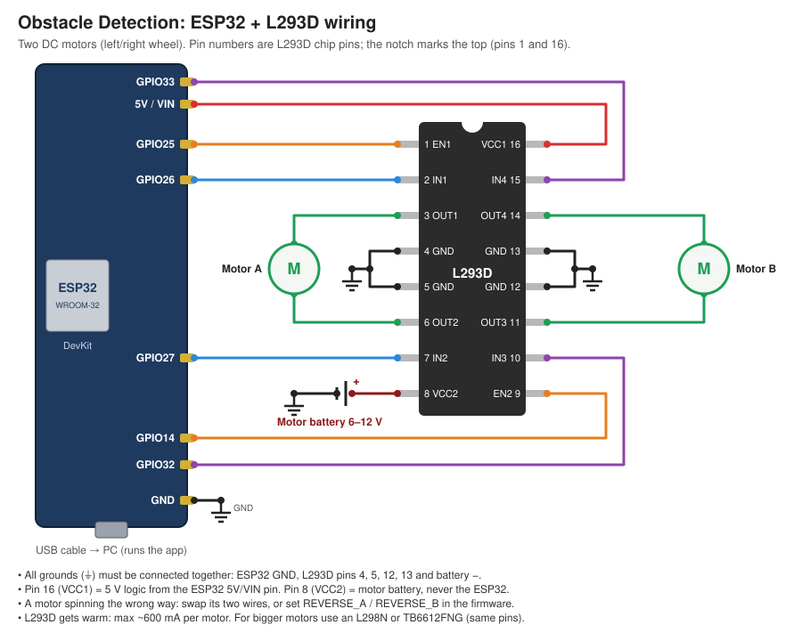

# Obstacle Detection: Pilot Assist

Watches the path ahead through a camera. When it sees an obstacle it:
1. **slows down** (to 30% by default),
2. **asks the pilot** "Obstacle ahead! Move forward?" with a countdown and an alert sound,
3. **stops** if the pilot does not answer in time (5 s by default) or presses Stop.

If the obstacle is **very close**, it stops immediately without asking. If the camera feed is
lost, it also stops. After a stop, the vehicle moves again only when the pilot presses **Resume**.

| Asking the pilot | No answer, so it stopped |
|---|---|
|  |  |

## Quick start (Windows)
1. Install [Python 3.10+](https://www.python.org/downloads/) and tick **"Add python.exe to PATH"** during setup.
2. Download this repo (**Code → Download ZIP**) and unzip it.
3. Double-click:

| File | What it does |
|---|---|
| `install.bat` | Creates a `venv` folder, installs the packages and offers to install YOLO (optional, ~2 GB) |
| `run.bat` | Starts the app (runs `install.bat` first if needed)|
| `run_sim.bat` | Starts in simulation mode: no camera needed, place obstacles with buttons |
| `stop.bat` | Closes the running app |

Command-line options can be passed through, e.g. `run.bat --source 1`.

## Manual setup (any OS)
```bash
pip install -r requirements.txt          # Linux also needs: sudo apt install python3-tk
pip install -r requirements-yolo.txt     # optional, much better detection
python app.py --sim                 # no camera needed: place obstacles with the GUI buttons
python app.py                       # webcam 0
python app.py --source 1 --timeout 8
```
Keys: **Y** = move forward / resume, **N** or **Space** = stop.

## How it decides
```
CRUISING ──obstacle──▶ WAITING FOR PILOT (slow) ──"forward"──▶ PROCEEDING (slow) ──clear──▶ CRUISING
                              ├──"stop"──────▶ STOPPED
                              ├──no answer───▶ STOPPED
                              └──clears──────▶ CRUISING
any state ──too close / camera lost──▶ STOPPED ──pilot "Resume"──▶ moving again
```
An object counts as an obstacle only inside the blue **path zone** (the middle 40% of the image).
Its height in the frame stands in for distance: at least 25% of the frame height gives a warning,
at least 55% means too close. Tune these in `detector.py`. Speeds, timeout and the ramp rates are
in `Config` in `controller.py`.

## ESP32 + L293D (driving real motors)
The PC does the camera work and decides the speed. It sends that speed to an **ESP32** over the USB
cable, and the ESP32 drives two DC motors through an **L293D**.



| ESP32 pin | L293D pin | Purpose |
|---|---|---|
| GPIO25 | 1 (EN1) | Motor A speed (PWM) |
| GPIO26 | 2 (IN1) | Motor A direction |
| GPIO27 | 7 (IN2) | Motor A direction |
| GPIO14 | 9 (EN2) | Motor B speed (PWM) |
| GPIO32 | 10 (IN3) | Motor B direction |
| GPIO33 | 15 (IN4) | Motor B direction |
| 5V / VIN | 16 (VCC1) | L293D logic power |
| GND | 4, 5, 12, 13 | Ground (also battery −) |
| | 8 (VCC2) | **Motor battery +** (6–12 V) |
| | 3 + 6 (OUT1, OUT2) | Motor A |
| | 11 + 14 (OUT3, OUT4) | Motor B |

**Steps**
1. Wire it as shown above. Connect all the grounds together.
2. Flash the firmware with the Arduino IDE. Install the **esp32 by Espressif** board package
   (Boards Manager), open `firmware/obstacle_esp32/obstacle_esp32.ino`, select **ESP32 Dev Module**
   and the right COM port, then click Upload.
3. *(Optional)* Test without the app: open the Serial Monitor at 115200 baud and type `S0.5`.
   Both motors should spin. They stop half a second later, because the safety watchdog expects
   commands to keep arriving.
4. Close the Serial Monitor, then start the app. In the **ESP32 (USB)** panel, pick the COM port and
   click **Connect**. You can also start it with `run.bat --port COM3`.

**Protocol:** one line per command at 115200 baud: `S<speed>`, with speed from `0.00` to `1.00`. The app
repeats the command every 0.2 s. If nothing arrives for 0.5 s (app closed or crashed, cable
pulled out), the ESP32 brakes the motors. If the ESP32 disconnects, the app shows **STOPPED**.

**Tuning** (top of the `.ino` file): if the motors hum but don't turn at low speed, raise `MIN_DUTY`.
If a motor runs backwards, set `REVERSE_A` / `REVERSE_B` (or swap that motor's two wires).

## Files
- `controller.py`: the state machine (the safety logic, no GUI); tests are in `tests/`
- `detector.py`: finds obstacles (YOLO if installed, otherwise a crude edge-based fallback)
- `vehicle.py`: `Esp32Vehicle` sends speeds to the ESP32
- `esp32_link.py`: USB serial connection and the ESP32 panel in the GUI
- `firmware/obstacle_esp32/`: the ESP32 sketch (Arduino)
- `app.py`: Tkinter GUI

> ⚠️ **Safety:** a single camera can only guess distance. On anything that really moves, add a
> distance sensor (ultrasonic, LiDAR or radar) and a hardware emergency stop. Do not rely on this
> software alone. Your motor controller should also stop by itself if it stops receiving speed
> commands (a watchdog), in case the app crashes or is force-closed.

## Tests
```bash
pip install pytest && python -m pytest tests
```
