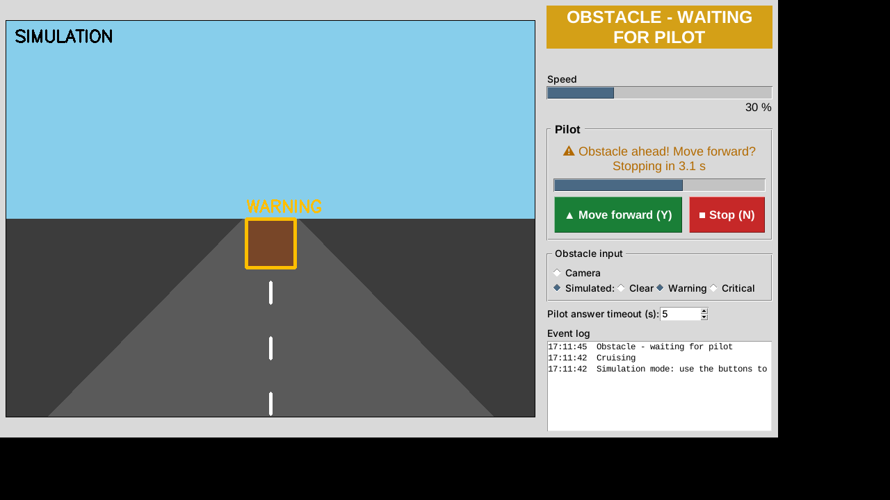
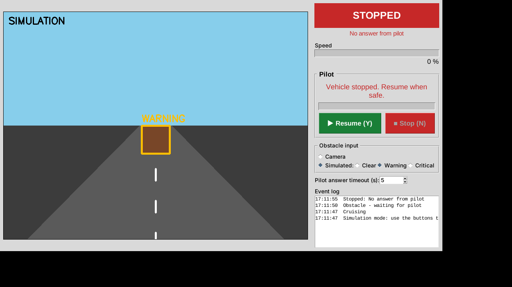

# Obstacle Detection: Pilot Assist

Watches the path ahead through a camera. When it sees an obstacle it:
1. **slows down** (to 30% by default),
2. **asks the pilot** "Obstacle ahead! Move forward?" with a countdown and an alert sound,
3. **stops** if the pilot does not answer in time (5 s by default) or presses Stop.

If the obstacle is **very close**, it stops immediately without asking. If the camera feed is
lost, it also stops. After a stop, the vehicle moves again only when the pilot presses **Resume**.

| Asking the pilot | No answer, so it stopped |
|---|---|
|  |  |

## Quick start (Windows)
1. Install [Python 3.10+](https://www.python.org/downloads/) and tick **"Add python.exe to PATH"** during setup.
2. Download this repo (**Code → Download ZIP**) and unzip it.
3. Double-click:

| File | What it does |
|---|---|
| `install.bat` | Creates a `venv` folder, installs the packages and offers to install YOLO (optional, ~2 GB) |
| `run.bat` | Starts the app (runs `install.bat` first if needed)|
| `run_sim.bat` | Starts in simulation mode: no camera needed, place obstacles with buttons |
| `stop.bat` | Closes the running app |

Command-line options can be passed through, e.g. `run.bat --source 1`.

## Manual setup (any OS)
```bash
pip install -r requirements.txt          # Linux also needs: sudo apt install python3-tk
pip install -r requirements-yolo.txt     # optional, much better detection
python app.py --sim                 # no camera needed: place obstacles with the GUI buttons
python app.py                       # webcam 0
python app.py --source 1 --timeout 8
```
Keys: **Y** = move forward / resume, **N** or **Space** = stop.

## How it decides
```
CRUISING ──obstacle──▶ WAITING FOR PILOT (slow) ──"forward"──▶ PROCEEDING (slow) ──clear──▶ CRUISING
                              ├──"stop"──────▶ STOPPED
                              ├──no answer───▶ STOPPED
                              └──clears──────▶ CRUISING
any state ──too close / camera lost──▶ STOPPED ──pilot "Resume"──▶ moving again
```
An object counts as an obstacle only inside the blue **path zone** (the middle 40% of the image).
Its height in the frame stands in for distance: at least 25% of the frame height gives a warning,
at least 55% means too close. Tune these in `detector.py`. Speeds, timeout and the ramp rates are
in `Config` in `controller.py`.

## Files
- `controller.py`: the state machine (the safety logic, no GUI); tests are in `tests/`
- `detector.py`: finds obstacles (YOLO if installed, otherwise a crude edge-based fallback)
- `vehicle.py`: motor interface. `SimulatedVehicle` is used by default, and `SerialVehicle` is an Arduino example.
- `app.py`: Tkinter GUI

## Connecting a real vehicle
In `app.py`, replace `SimulatedVehicle()` with your own `Vehicle` subclass (or `SerialVehicle("/dev/ttyUSB0")`).
`set_speed()` is called about 20 times per second with a value from 0 to 1.

> ⚠️ **Safety:** a single camera can only guess distance. On anything that really moves, add a
> distance sensor (ultrasonic, LiDAR or radar) and a hardware emergency stop. Do not rely on this
> software alone. Your motor controller should also stop by itself if it stops receiving speed
> commands (a watchdog), in case the app crashes or is force-closed.

## Tests
```bash
pip install pytest && python -m pytest tests
```
